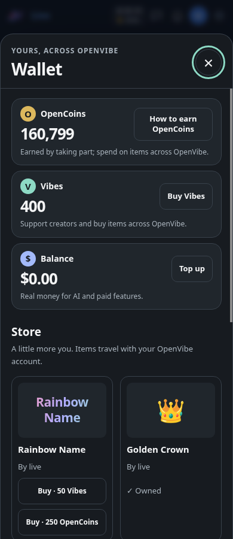
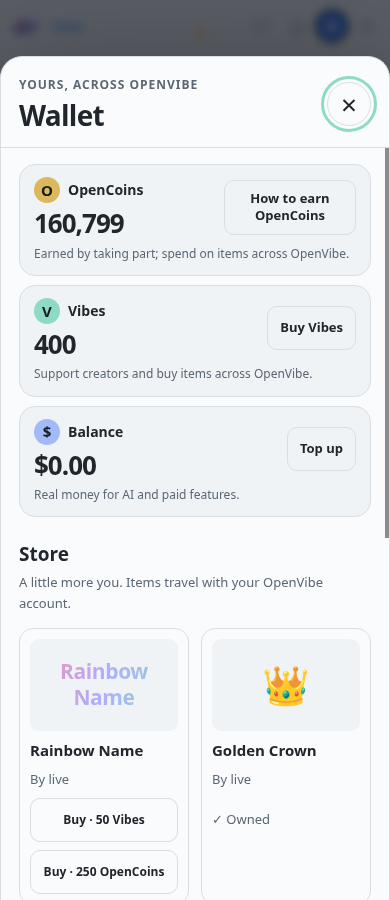
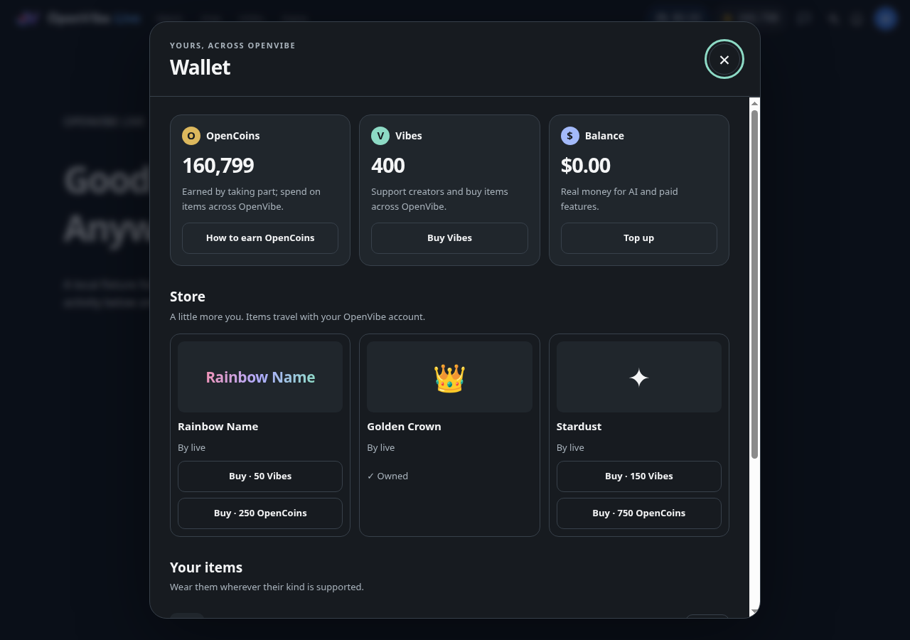
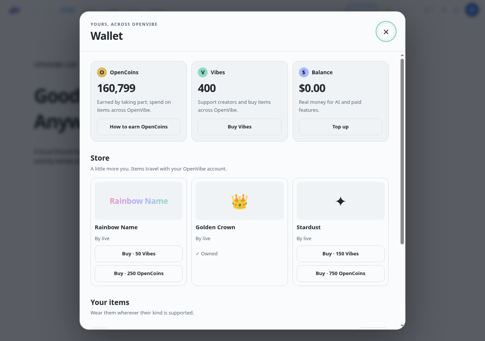

# Shared Wallet

The signed-in navbar reads GET /api/v1/me/wallet once per minute and shows two balances, keeping the third in Wallet. Ranking compares Vibes and Balance at Billing’s USD value rate; OpenCoins uses its spendable count because it has no cash exchange rate. A zero Balance is shown first when the person used AI this month. Unavailable balances show an ellipsis, never a false zero. Account changes discard old responses and close private content.

The first chip tap loads ov-wallet.js and ov-wallet.css. Native dialog focus containment, Escape, outside-click dismissal, a locked page and an internal scroller work at phone and desktop widths. All three balances include zeros and an action. The sheet reads the reviewed Inventory catalogue and the person's items, marks owned items, buys via Billing-backed orders, equips/unequips, and shows five recent events with their source. Checkout opens the provider in the same tab. Failed or uncertain actions keep their idempotency key while retrying.

OpenVibeNavbar.openWallet() opens the shared sheet from a site action. OpenVibeNavbar.refreshWallet() refreshes balances after a site completes a money action. frameBase (default https://openvibe.network/api/frame) configures where the sheet asks; every request goes through Network's /api/frame/wallet/… relays, because each site's connect-src allows openvibe.network and refuses billing./inventory.openvibe.network. Network forwards only the person's Bearer token (never a cookie), fixed paths, JSON bodies of at most 8 KB, and passes Billing's/Inventory's status and body back.

A hosted checkout is followed only when its URL is https with no credentials and its host is one Billing names for the chosen provider (checkout.providers: [{ name, hosts }]) or is billing.openvibe.network; otherwise the sheet shows "Checkout is unavailable." and stays put.

Rollout requires the companion Billing/Inventory APIs, reviewed listings, enabled checkout providers (with their hosts in Billing's offers), and the Network wallet relays. The Inventory API serves bearer CORS without cookies. Release/pin alongside the companion PRs; no deployment is performed here.

Screenshots use deterministic local sample balances and items, not a production account. The Chrome test verifies both sizes/themes, overflow, 44px controls, first-tap loading, equip, checkout, Escape, account switching and console/CSP errors. Capture with WALLET_SCREENSHOT_DIR=docs/screenshots ov test test/wallet-chrome.test.js.

